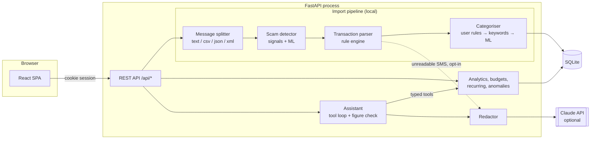
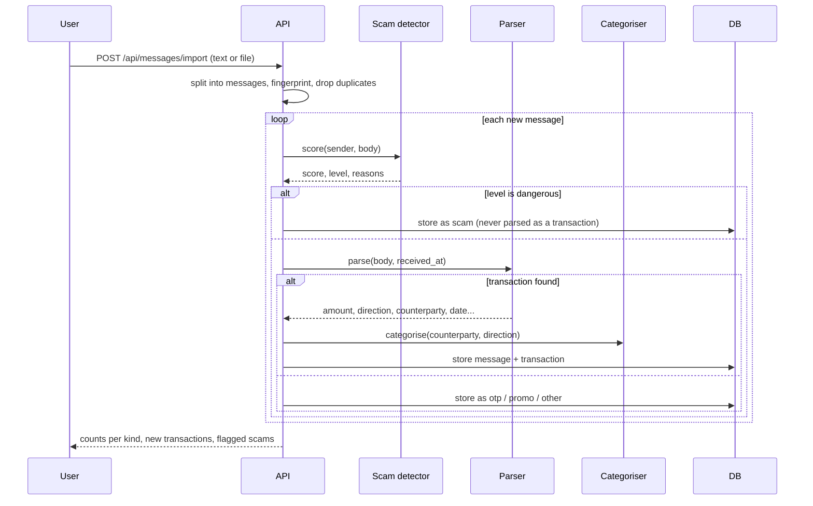
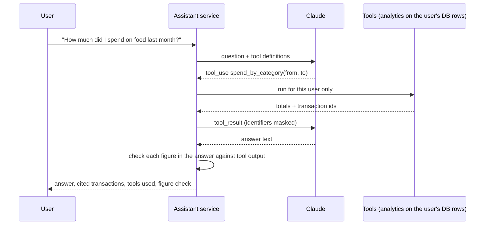

# Architecture

## 1. System overview

One Python process serves the JSON API and the built React app. SQLite holds all state. The only
outbound call is to the LLM provider, and only for features the user triggers.



## 2. Import pipeline



A message scored as dangerous is never turned into a transaction. Scam texts often imitate debit
alerts ("Rs 4,999 will be debited, click to cancel"), and counting them would corrupt the ledger.

## 3. Where the AI is

| Component | Technique | Runs | Purpose |
|---|---|---|---|
| Scam detector | Explainable signal rules combined with a TF-IDF + logistic regression text model | Local | Risk score with reasons |
| Categoriser | User rules, then a keyword dictionary, then a character n-gram classifier over merchant names | Local | Handles merchants no dictionary lists, e.g. "SRI BALAJI MEDICALS" |
| Recurring and anomaly detection | Interval and amount statistics | Local | Subscriptions, unusual spends |
| Ask Summa | Claude with tool calling over typed analytics functions | LLM | Natural-language answers with citations |
| Figure check | Every number in an answer is matched against tool output | Local | Flags figures the model did not get from data |
| Insight narrative | Claude rewrites computed facts | LLM | Readable monthly summary |
| Fallback parser | Claude structured output | LLM, opt-in | SMS formats the rule engine cannot read |

### Ask Summa in detail



- Tools take a `user_id` from the session, never from the model, so a prompt cannot reach another
  user's data.
- The loop is capped at six tool rounds.
- The model is told to call `calculate` for any arithmetic. The figure check then verifies the
  result instead of trusting the instruction.

## 4. Backend layout

```
backend/app/
  main.py            app factory, static files, error handlers
  config.py          settings from environment variables
  db.py              engine, session, schema creation
  models.py          SQLAlchemy models
  schemas.py         request and response models
  security.py        password hashing, session tokens, rate limiter
  deps.py            current-user dependency
  routers/           auth, messages, transactions, analytics, budgets, scam, assistant, account
  services/
    splitter.py      raw text / csv / json / xml → messages
    sms_parser.py    transaction extraction
    categorizer.py   category assignment
    scam_detector.py risk scoring
    analytics.py     summaries, recurring, anomalies, insights
    budgets.py       suggestions, progress, projection
    assistant.py     tool definitions, tool loop, figure check
    llm.py           provider wrapper
    redact.py        identifier masking
    sample_data.py   synthetic inbox generator
```

## 5. Frontend layout

```
frontend/src/
  api/         typed client, one function per endpoint
  pages/       Landing, Dashboard, Transactions, Budget, Shield, Ask, Import, Settings
  components/  layout, charts, tables, states (loading / empty / error)
```

Session state lives in an HTTP-only cookie. The SPA holds no token.

## 6. Authentication and authorisation

- Passwords: scrypt with a per-user random salt.
- Sessions: 32 random bytes sent as an `HttpOnly`, `SameSite=Strict` cookie. Only the SHA-256 of the
  token is stored, so a database leak does not expose live sessions.
- Every query filters by the session's `user_id`.
- Sign-up, log-in and assistant endpoints are rate limited.

## 7. Security requirements

| Risk | Control |
|---|---|
| Cross-user data access | `user_id` filter on every query; tests assert isolation |
| Session theft through script injection | HTTP-only cookie; React escapes all rendered SMS text |
| Cross-site request forgery | `SameSite=Strict` cookie; API accepts JSON, not form posts |
| Prompt injection through SMS text | SMS content reaches the model only as tool-result data; tools are read-only and scoped to the user |
| Leaking identifiers to the LLM | Account numbers, card numbers, phone numbers, UPI IDs, PAN and Aadhaar patterns are masked |
| Malicious upload | Size cap, UTF-8 text only, XML with DTD or entities rejected |
| Secrets in the repo | `.env` is git-ignored; `.env.example` holds names only |
| Credential stuffing | Rate limit per IP on auth endpoints |

## 8. Deployment

A multi-stage Dockerfile builds the frontend, then copies it into a slim Python image. The
container listens on `$PORT`. SQLite lives on a mounted volume; set `DATABASE_URL` to use Postgres.
See `DEPLOYMENT.md`.
