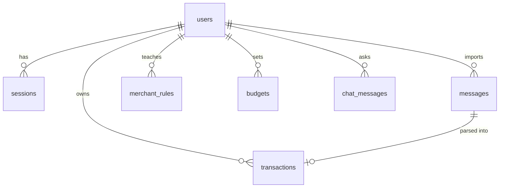

# Database

SQLite by default (`backend/data/summa.db`), created at start-up. Set `DATABASE_URL` to any SQLAlchemy URL to use Postgres. Money is stored as **integer paise** to avoid floating-point drift. Times are stored as naive Indian Standard Time; session and audit timestamps are naive UTC.

| Table | Key columns | Notes |
|---|---|---|
| `users` | `id`, `email` (unique), `name`, `password_hash`, `is_demo`, `created_at` | scrypt hash with a per-user salt |
| `sessions` | `user_id`, `token_hash` (unique), `expires_at` | Only the SHA-256 of the session token is stored |
| `messages` | `user_id`, `sender`, `body`, `received_at`, `kind`, `scam_score`, `scam_level`, `scam_reasons` (JSON), `parse_source` (rules/llm/none), `dismissed`, `fingerprint` | Unique `(user_id, fingerprint)` prevents duplicate imports. `kind`: transaction, scam, otp, promo, other |
| `transactions` | `user_id`, `message_id`, `occurred_at`, `amount_paise`, `direction` (debit/credit), `counterparty`, `counterparty_key`, `channel`, `account_tail`, `balance_paise`, `reference`, `category`, `category_source` (user/rule/ml), `category_confidence`, `note` | Index on `(user_id, occurred_at)`. Only the last four digits of an account are kept |
| `merchant_rules` | `user_id`, `counterparty_key`, `category` | Unique per user and merchant. Applied before any other categoriser |
| `budgets` | `user_id`, `category`, `monthly_limit_paise` | Unique per user and category |
| `chat_messages` | `user_id`, `role`, `content`, `meta` (JSON: citations, tools, figure check) | |

All foreign keys cascade on user deletion. Every query in the API filters by the session's `user_id`; `tests/test_api.py::test_users_cannot_see_each_other` checks this.

**Migrations.** The schema is created with `create_all`. There is no migration tool; a schema change on an existing database needs a manual migration or a fresh database. See KNOWN_LIMITATIONS.md.
